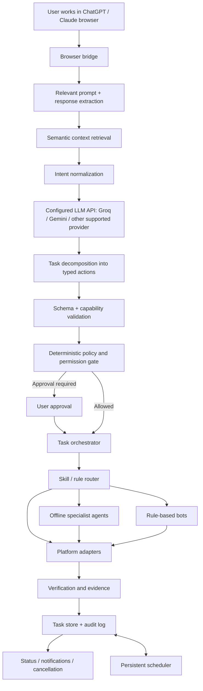

# RFC 002: System Architecture

- **Status:** Proposed
- **Depends on:** RFC 001, RFC 007
- **Scope:** MVP architecture and component boundaries

## 1. Summary

Lemon observes a supported assistant browser context, identifies the user's active intent, uses a configured model API to decompose the task, and dispatches the resulting typed plan to small offline agents, deterministic rule-based bots, and platform adapters.

The system separates **context capture**, **task decomposition**, **policy**, and **execution**. A model can propose a plan, but cannot authorize itself or directly execute arbitrary code.

## 2. High-level flow

## 3. Components

### 3.1 Browser bridge

A browser extension or equivalent supported integration identifies supported assistant pages and captures only relevant page content. It should distinguish user-authored prompts from assistant-generated replies and avoid collecting unrelated tabs or hidden sensitive content.

### 3.2 Context extraction and semantic retrieval

Extract conversation turns, selected page context, and task-relevant references. Semantic retrieval should search a bounded local index of relevant captured turns or approved sources, not silently index the user's entire browsing history.

Context must retain provenance: user request, assistant response, retrieved content, and system-generated inference must be distinct. Assistant replies can help clarify a task but do not override the user's request or Lemon policy.

### 3.3 Intent normalizer

Convert captured context into a normalized request with:
- User goal and source turn.
- Entities, constraints, and relevant dates.
- Requested target application/site.
- Whether the user wants information, a one-time action, or persistent monitoring.
- Missing details and confidence/ambiguity flags.

If the active intent cannot be reliably distinguished from quoted text or old conversation content, ask the user to select/confirm the request.

### 3.4 Online decomposition model

A configured LLM API (initial candidates: Groq-hosted models, Gemini, or another provider selected by the user/team) converts the normalized request into a structured task plan.

The provider interface must be replaceable. Send only the minimum context required, disclose remote processing, and follow provider terms, quotas, and data handling requirements. Do not assume all providers support the same tools or schemas.

The model proposes actions; it does not decide permissions or execute tools.

### 3.5 Plan validator and policy gate

Validate the plan against a versioned action schema and allowlist. Reject arbitrary code, unsupported actions, malformed arguments, invalid targets, and plans that exceed configured budgets.

A deterministic policy engine independently checks permissions, risk, scopes, approval requirements, and whether actions still match the user's intent.

### 3.6 Agent and rule router

Route each action to the narrowest capable handler:
- A small offline specialist agent for a bounded language or perception task.
- A deterministic rule-based bot for exact, repeatable operations.
- A platform adapter for browser, OS, file, notification, or service interaction.
- The configured LLM API only when decomposition or reasoning is required.

Avoid invoking a model for deterministic operations such as date normalization, schema validation, simple comparisons, retries, or state transitions.

### 3.7 Offline specialist agents

Small offline agents (the project intends to evaluate Cactus/Spine-style agents) should be task-specific, resource-bounded, and callable through a common interface. Their exact model/runtime, supported device, license, and memory/latency characteristics must be verified before selection.

Agents must not receive broad device permissions. They return typed proposals or extracted values; the orchestrator validates outputs and routes any resulting action through policy.

### 3.8 Rule-based bots

Rule bots handle well-defined workflows with deterministic inputs and explicit postconditions. Examples: create a reminder through a supported interface, compare a normalized price to a threshold, format a notification, or check whether a due task is eligible to run.

Rules should be versioned, unit-tested, and observable. A rule bot must return failure or uncertainty rather than silently improvising when its preconditions are not met.

### 3.9 Platform adapters

Adapters implement the actual supported interaction: browser APIs, desktop UI, filesystem operations within scoped roots, reminders/notifications, or direct service APIs. The orchestrator does not contain platform-specific details.

### 3.10 Verification and task store

Persist task state, sanitized action results, schedule metadata, approvals, and evidence references. Verify intended postconditions wherever possible. A sent click or keystroke is not itself proof of success.

## 4. Request routing

Suggested first-pass routing table:

| Task kind | Preferred handler |
|---|---|
| Parse dates, normalize values, compare thresholds | Deterministic code / rule bot |
| Monitor a known value and notify on threshold | Scheduler + observer + rule evaluator |
| Extract a field from a known UI pattern | Parser or small offline agent |
| Classify task or route a known intent | Small local classifier / rule table |
| Decompose an unfamiliar multi-step request | Configured LLM API |
| Interact with browser/OS | Approved platform adapter |
| Verify a consequential side effect | Adapter evidence plus postcondition check |

## 5. Data model

- **ConversationContext:** source, captured turns, timestamps, retention policy, provenance.
- **Task:** id, user goal, source reference, status, created/updated timestamps.
- **Plan:** task id, schema version, typed actions, dependencies, expected outcomes.
- **ActionRun:** action id, handler type, status, attempts, sanitized result, evidence reference.
- **Automation:** trigger, schedule/condition, expiry, next run, notification policy.
- **Approval:** action id, scope, decision, timestamp, policy version.
- **AuditEvent:** actor, event, target, timestamp, sanitized metadata.
- **ProviderConfig:** provider name, model identifier, enabled status, secret reference.
- **AgentCapability:** handler id, supported action types, resource budget, version.

Credentials must be held in secure storage and referenced by ID, not copied into task records.

## 6. Local-first execution and quota philosophy

Lemon should avoid charging a separate per-action quota for local execution where practical. The configured LLM API may still have quotas, rate limits, and costs. Device availability, website limits, and third-party terms also apply.

Use the online decomposer sparingly: route known tasks to rules or offline agents, and invoke the model when the task is ambiguous or requires multi-step decomposition. Cache only safe, non-sensitive reusable artifacts with a defined invalidation policy; never reuse stale authorization as consent for a new action.

## 7. Reliability

- Typed actions only; no arbitrary model-generated shell execution.
- Timeouts, bounded retries, cancellation, and idempotency safeguards.
- Persistent task state before and after side effects.
- Resume only from safe checkpoints.
- `unknown` is a valid outcome.
- Partial completion is represented explicitly.
- External page content is treated as untrusted input.

## 8. MVP sequence

1. Supported browser bridge with explicit capture/opt-out.
2. One configured decomposition provider and strict JSON schema.
3. Three to five deterministic rule bots.
4. One or two offline agents with measurable capability and resource budgets.
5. One platform adapter end-to-end.
6. Verification, task history, cancellation, and one persistent automation.
7. Add other providers/platforms only after the first vertical slice is reliable.

## 9. Open decisions

- First target: Chrome/Chromium desktop, Android, or both?
- Which exact Cactus/Spine implementation, license, runtime, and supported hardware?
- Which model provider is default, and how are API keys configured?
- Which assistant DOM surfaces are supported and how will UI changes be tested?
