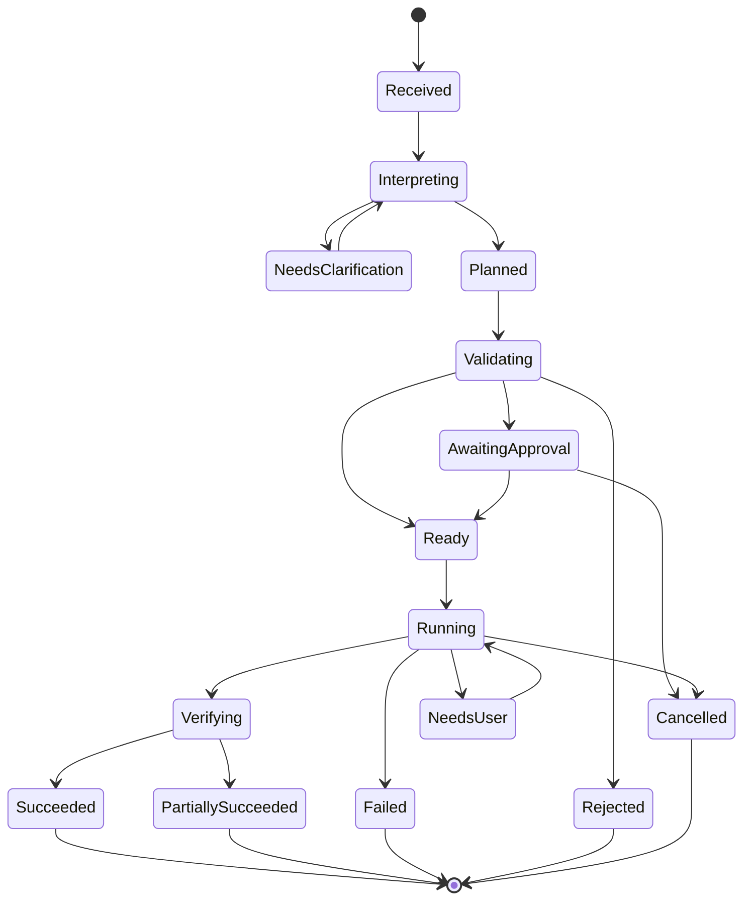

# RFC 003: Task Execution Protocol

- **Status:** Proposed
- **Depends on:** RFC 002, RFC 004
- **Scope:** From natural-language intent to verified result

## 1. Summary

This RFC defines the common lifecycle for interactive and automated tasks. Every task must pass through normalization, planning, validation, policy evaluation, execution, verification, and reporting. A model can propose an interpretation or plan, but only validated typed actions may reach an executor.

## 2. Design requirements

- The protocol is independent of any one assistant or model.
- Every task has a stable ID and a durable state.
- Actions have explicit inputs, expected outcomes, risk classification, and timeout.
- User approval is represented as a first-class state.
- Retries must account for duplicate side effects.
- Results distinguish success, failure, partial completion, and uncertainty.
- Cancellation is propagated where the underlying adapter supports it.

## 3. Task lifecycle



## 4. Protocol stages

### Stage 1: Receive

Create a task record with a unique ID, source channel, timestamp, user intent, and relevant context references. Keep the original request separate from inferred fields.

### Stage 2: Interpret

Extract the intended outcome, entities, constraints, time bounds, and required permissions. Classify the task as a known workflow, a multi-step plan, research, or clarification-required.

If a date or time is ambiguous, use the user's locale and explicit context where available. Do not silently infer a high-impact target or recipient.

### Stage 3: Plan

Produce a sequence of typed actions with explicit dependencies and expected postconditions. Example:

- `browser.navigate(url)`
- `browser.find_text(query)`
- `notification.create(message, schedule)`
- `email.prepare(recipient, subject, body)`

These names are illustrative. The implementation must define a versioned allowlist of supported actions. Do not permit a model to submit arbitrary shell commands or code as a generic action.

### Stage 4: Validate

Validate schema, parameters, target origin, permitted scope, action ordering, timeout, and postconditions. Reject unsupported actions. Sanitize untrusted content and treat webpage text as data, not as instructions that can override the user's intent or Lemon's policy.

### Stage 5: Authorize

Evaluate policy for each action. If required, show the user a concise preview of the exact consequential action and its target. Record the approval decision and the scope it covers. Approval of one action must not automatically authorize unrelated future actions.

### Stage 6: Execute

Run actions through adapters. Respect dependencies, deadlines, cancellation, and per-action timeouts. Use bounded concurrency only for independent actions. Record sanitized outputs and state transitions.

### Stage 7: Verify

Evaluate the expected postconditions using available evidence. A successful input event is not proof that the requested outcome occurred. If evidence is inconclusive, return `unknown` or ask the user to inspect the result.

### Stage 8: Report

Summarize what was completed, what failed, what remains pending, and any action requiring user intervention. Never claim an action was completed unless the executor or verification layer has adequate evidence.

## 5. Typed action envelope

Illustrative JSON:

```json
{
  "schema_version": "1.0",
  "task_id": "task_opaque_id",
  "actions": [
    {
      "id": "action_1",
      "type": "reminder.create",
      "arguments": {
        "title": "Project meeting",
        "due_at": "2026-11-13T16:00:00+05:30",
        "timezone": "Asia/Kolkata"
      },
      "depends_on": [],
      "risk": "low",
      "timeout_ms": 10000,
      "expected_outcome": {
        "type": "reminder.exists"
      }
    }
  ]
}
```

IDs above are illustrative. The schema must validate dates, timezone handling, supported action names, and all arguments. Never assume a reminder was created merely because a request was accepted.

## 6. Result contract

An action result should include:

- `status`: `succeeded`, `failed`, `needs_user`, `cancelled`, or `unknown`.
- `started_at` and `finished_at`.
- `attempt`.
- `summary`.
- `evidence_ref`, if available.
- `retryable`.
- Sanitized `error_code` and details, if any.

A task may finish as `partially_succeeded` when some independent actions completed and others did not. Preserve completed outcomes rather than rerunning the whole plan indiscriminately.

## 7. Retry and idempotency

- Retry transient failures only within a bounded policy.
- Never blindly retry sends, purchases, deletes, or other non-idempotent operations after an ambiguous timeout.
- Before retrying, check whether the side effect may already have happened.
- Prefer adapter-level idempotency keys where supported.
- Expose repeated-attempt uncertainty to the user when it cannot be resolved.

## 8. User interaction and approval

Pause when required information is missing, the target is ambiguous, authentication is needed, a CAPTCHA or human check appears, or the policy requires confirmation. Ask the smallest useful clarification question. Do not attempt to bypass access controls or human verification.

## 9. Prompt injection and untrusted content

Content from webpages, emails, documents, and app screens may contain hostile instructions. Treat it as untrusted input. It can provide facts relevant to the user's task, but it cannot grant permissions, alter system policy, or authorize unrelated actions. Re-check all proposed actions against the original user goal and policy gate.

## 10. Acceptance criteria

- Invalid plans never reach adapters.
- A task can pause for approval and resume without losing state.
- Cancellation prevents not-yet-started actions where possible.
- Non-idempotent ambiguous failures are not blindly retried.
- Every terminal task has a truthful summary.
- Unit tests cover invalid arguments, malicious page text, timeouts, retries, and partial completion.
