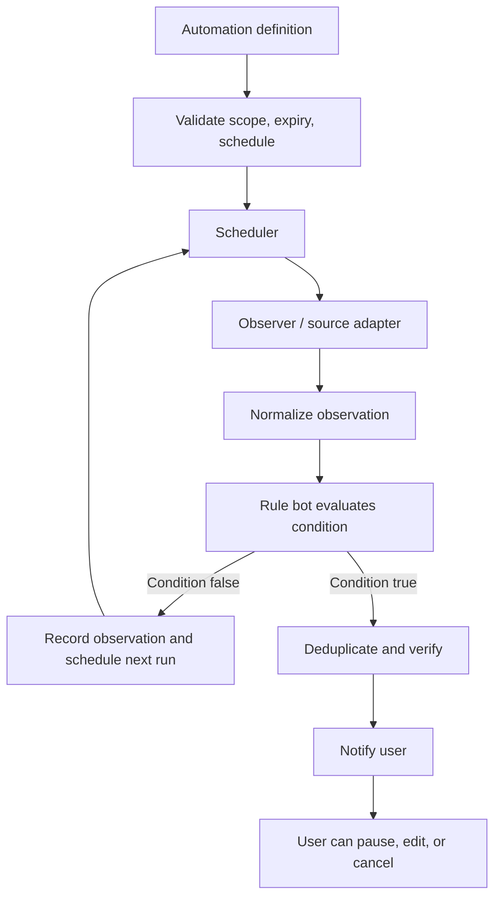

# RFC 005: Persistent Automation Engine

- **Status:** Proposed
- **Depends on:** RFC 002, RFC 003, RFC 004
- **Scope:** Scheduled and condition-based tasks

## 1. Summary

The automation engine runs tasks beyond the original conversation. It persists triggers and conditions, schedules observations, dispatches eligible work through the standard task protocol, and notifies the user when verified outcomes matter.

## 2. Trigger types

- **One-time schedule:** a reminder or action at a specific time and timezone.
- **Recurring schedule:** run a bounded workflow on a defined recurrence.
- **Condition monitor:** observe a product/page/source and alert when a condition is met.
- **One-shot research:** find and compare hotels or products now; ongoing monitoring is a separate opt-in task.

## 3. Engine flow

## 4. Required record fields

`id`, `owner_id`, `status`, `trigger_type`, `schedule_rule` or `condition_definition`, timezone, created/updated timestamps, expiry, next/last run, polling interval, run budget, notification policy, deduplication state, and policy version.

Secrets are stored separately in secure storage.

## 5. Scheduling semantics

- Persist schedules across app restarts.
- Preserve the intended timezone and define daylight-saving behavior.
- Define a missed-run policy.
- Prevent overlapping runs unless explicitly supported.
- Use bounded retries and backoff.
- Make pause, resume, edit, and cancellation durable.
- Disclose when a local task requires the device to be online or awake.

A hosted scheduler can enable remote execution but adds cost, privacy implications, and operational complexity.

## 6. Monitoring pipeline

1. Resolve the source.
2. Observe through a permitted adapter.
3. Normalize the value.
4. Evaluate the condition deterministically.
5. Deduplicate unchanged states.
6. Notify with timestamp and evidence.
7. Record a sanitized run log.

Prefer official APIs or feeds when available and authorized. Respect website terms and rate limits. If a source is stale, unavailable, or has changed structure, mark the result uncertain instead of inventing a value.

## 7. Resource controls

- Use reasonable configurable polling intervals.
- Apply per-automation execution budgets and expiry.
- Back off on errors or throttling.
- Avoid repeated expensive model calls when a rule can compare values locally.
- Do not treat “unlimited requests” as permission to overload websites or consume unlimited hosted inference.

## 8. Acceptance criteria

- A scheduled task survives restart.
- Users can pause, edit, resume, and cancel.
- Condition monitors deduplicate alerts.
- Stale observations are never presented as confirmed.
- Recurring runs are bounded and do not overlap unintentionally.
- Each run has an inspectable status and sanitized log.
